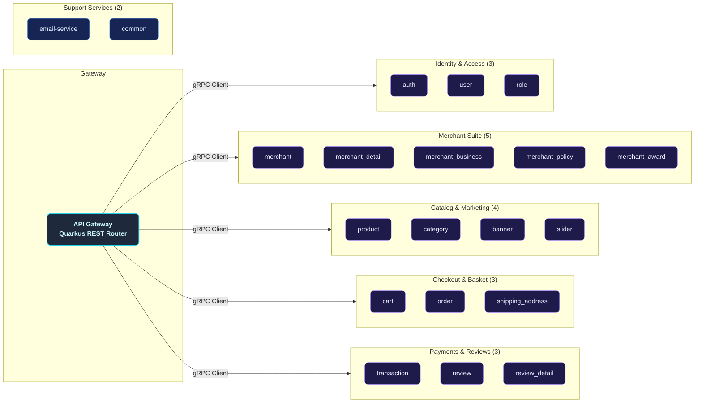
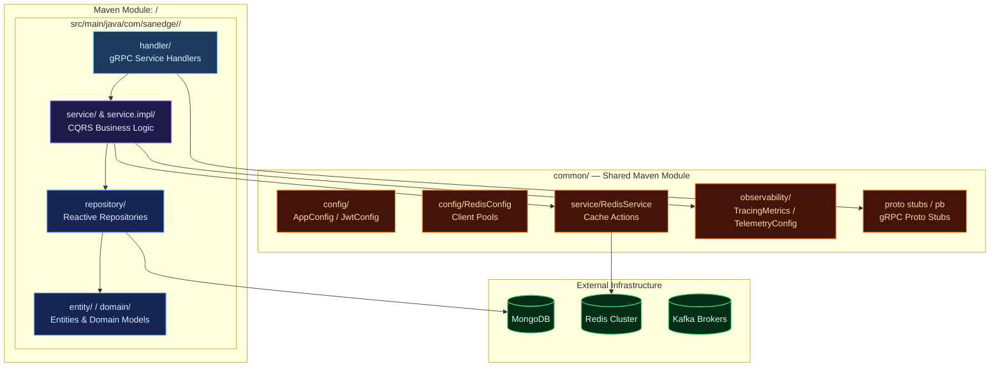
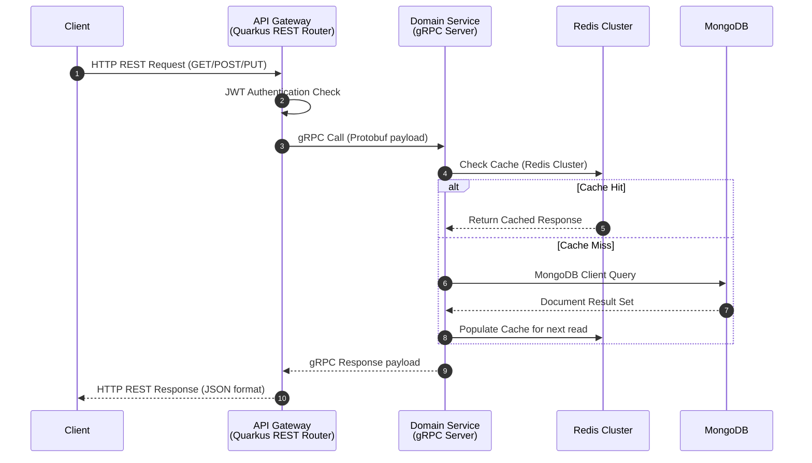
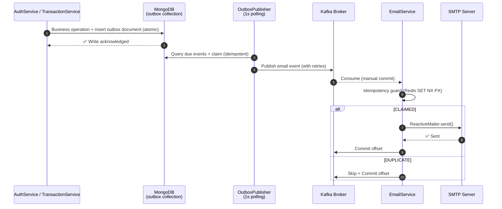
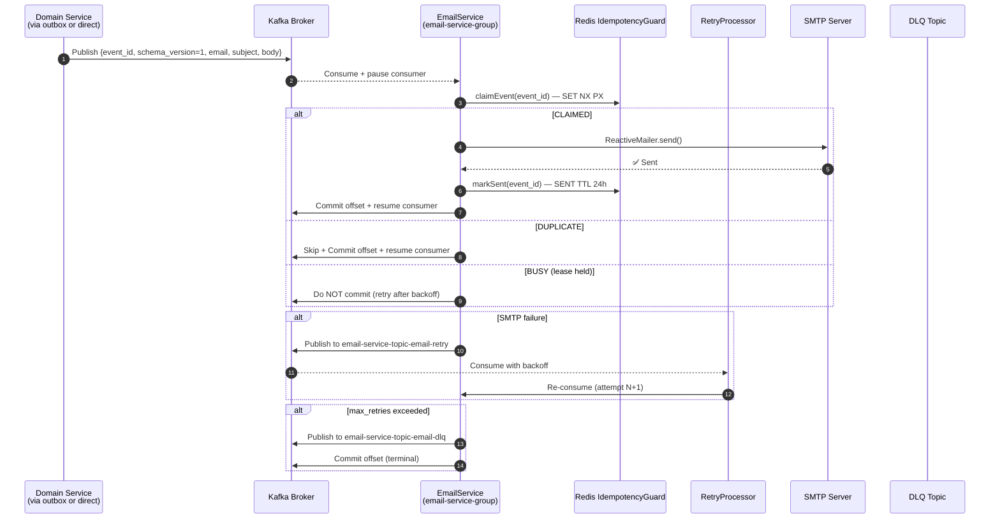
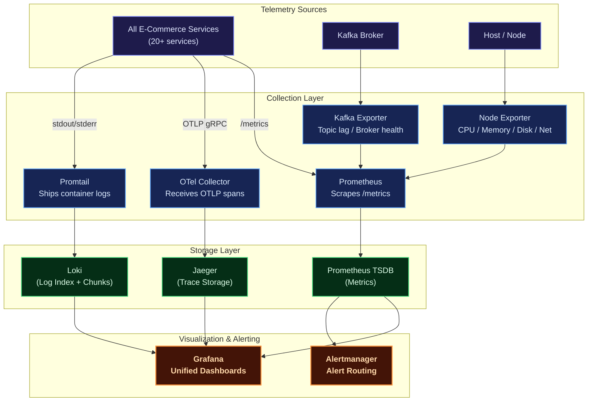
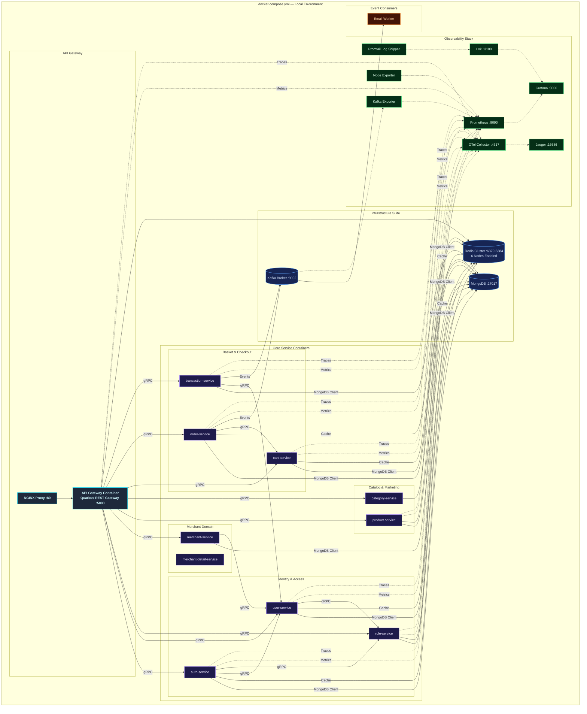

# Distributed Modular Monolith — E-Commerce Platform (Java Quarkus)

A production-grade, highly resilient, and fully observable **modular-monolith e-commerce backend** built in **Java 21** using **Quarkus** reactive framework (v3.31.3). Designed around domain-driven service boundaries following Clean Architecture and CQRS principles, it retains the operational and deployment simplicity of a single deployment unit while maintaining logical isolation typical of microservices.

Each e-commerce business domain — Users, Roles, Auth, Products, Categories, Cart, Orders, Shipping, Merchants, Reviews, Transactions, Banners, Sliders — lives in its own self-contained Maven module. These modules communicate synchronously via high-performance **gRPC** protocols and asynchronously using **Apache Kafka** event propagation, exposing a unified reactive entry point through a **REST API Gateway** powered by Quarkus RESTEasy Reactive.

The platform is fortified with a **comprehensive observability suite** (Prometheus, Grafana, Loki, Jaeger, OpenTelemetry), **MongoDB Panache** persistence via the reactive MongoDB client, **distributed Redis Cluster caching** with custom telemetry for each service, and Kubernetes configurations ready for production auto-scaling.

---

## Key Features

| Domain | Capabilities |
| :--- | :--- |
| **Auth & Users** | Secure registration, multi-factor login, stateless JWT access/refresh token lifecycle, password reset workflows, OTP email verification, and `/me` profile REST endpoint. |
| **Roles & RBAC** | Custom permission configuration, granular access control matrices, and sub-second permission evaluation cached via Redis. |
| **Catalog & Products** | Full CRUD for products & categories, promo banners, and home slider carousels. |
| **Cart & Commerce** | Add-to-cart, checkout workflows, order lifecycle management, order-item decomposition, and shipping address details. |
| **Merchants** | Fully featured merchant onboarding, profile details management, business data registration, policies, and merchant awards. |
| **Transactions** | Centralized financial audit ledger collecting transaction and payment events across the system, global search filters, and status tracking. |
| **Reviews** | Product ratings & detailed review submissions post-purchase. |
| **Email Worker** | Kafka-driven asynchronous worker dispatching critical notification emails (OTPs, login alerts, merchant onboarding notices, and transaction invoices) via SMTP. |
| **Observability** | Multi-dimensional metrics (Prometheus + Grafana), log aggregation (Loki + Logback), end-to-end distributed tracing (Jaeger + OpenTelemetry), and resource monitors (Node, Kafka Exporters). |
| **Deployment** | Local orchestration using Docker Compose (featuring a 6-node Redis Cluster), and auto-scaling Kubernetes manifests configured with Horizontal Pod Autoscalers (HPA). |

---

## Architecture Overview

The platform implements a **Distributed Modular Monolith** architecture. Each business service is logical, decoupled, and self-contained inside its own Maven submodule, possessing its own independent gRPC boundary. A **Quarkus REST API Gateway** acts as the unified edge router, transforming client HTTP REST requests into fast gRPC downstream communications via Quarkus gRPC clients.

### Core Architecture Principles

- **Domain-Driven Boundary Isolation**: Every service owns its database access, caching layers, and service logic, strictly forbidding cross-boundary database sharing.
- **Clean Architecture & CQRS**: Separation of concerns using `Handler (gRPC) → Service (Command/Query) → Repository (Command/Query)` layers ensures business logic remains clean, performant, and framework-agnostic.
- **Reactive execution**: Powered entirely by Quarkus reactive engine and Mutiny, enabling high throughput with minimal resource footprints.
- **MongoDB Persistence**: Employs the reactive MongoDB Panache client for non-blocking, document-oriented persistence shared across the multiple concurrent modular services.
- **Event-Driven Resilience**: Apache Kafka decouples transaction events, ensuring side effects like email billing remain completely non-blocking.
- **OTel Telemetry Integration**: Standardized OpenTelemetry middleware injects trace IDs across gRPC boundaries, allowing seamless trace propagation from the client REST gateway down to MongoDB operations.

```mermaid
graph TB
    classDef client fill:#0f172a,stroke:#38bdf8,color:#e0f2fe,stroke-width:2px,font-weight:bold
    classDef gateway fill:#1e293b,stroke:#22d3ee,color:#cffafe,stroke-width:2px,font-weight:bold
    classDef domain fill:#1e1b4b,stroke:#818cf8,color:#e0e7ff,stroke-width:1.5px
    classDef infra fill:#172554,stroke:#60a5fa,color:#dbeafe,stroke-width:1.5px
    classDef obs fill:#052e16,stroke:#4ade80,color:#dcfce7,stroke-width:1.5px
    classDef event fill:#431407,stroke:#fb923c,color:#fed7aa,stroke-width:1.5px

    Client["Client Applications<br/>(Web / Mobile / API)"]:::client

    subgraph APIGateway["API Gateway — NGINX + Quarkus REST Gateway"]
        direction LR
        REST["REST API Route Handler<br/>Port :5000"]:::gateway
        AuthMW["JWT Auth & Role<br/>Middleware"]:::gateway
    end

    Client -->|HTTP REST| APIGateway

    subgraph BusinessServices["Business Domain Services (Java Quarkus)"]
        direction TB

        subgraph IdentityDomain["Identity & Access"]
            AUTH["Auth Service<br/>JWT & BCrypt Server"]:::domain
            USER["User Service<br/>Profile Management"]:::domain
            ROLE["Role Service<br/>RBAC & Permissions"]:::domain
        end

        subgraph MerchantDomain["Merchant Suite"]
            MERCH["Merchant Service<br/>Onboarding & Profiling"]:::domain
            MERCH_DETAIL["Merchant Detail Service"]:::domain
            MERCH_BIZ["Merchant Business Service"]:::domain
            MERCH_POLICY["Merchant Policy Service"]:::domain
            MERCH_AWARD["Merchant Award Service"]:::domain
        end

        subgraph CatalogDomain["Catalog & Marketing"]
            PROD["Product Service<br/>Product Catalog CRUD"]:::domain
            CAT["Category Service<br/>Product Categorization"]:::domain
            BANNER["Banner Service<br/>Offers & Promos"]:::domain
            SLIDER["Slider Service<br/>Carousel Slides"]:::domain
        end

        subgraph OrderDomain["Checkout & Cart"]
            CART["Cart Service<br/>Basket Operations"]:::domain
            ORDER["Order Service<br/>Checkout & Order Flows"]:::domain
            SHIP["Shipping Service<br/>Customer Addresses"]:::domain
        end

        subgraph TransactionDomain["Payments & Reviews"]
            TXN["Transaction Service<br/>Central Audit Register"]:::domain
            REV["Review Service<br/>Ratings & Feedback"]:::domain
            REV_DTL["Review Detail Service"]:::domain
        end
    end

    REST -->|"Quarkus gRPC Client"| AUTH
    REST -->|"Quarkus gRPC Client"| USER
    REST -->|"Quarkus gRPC Client"| ROLE
    REST -->|"Quarkus gRPC Client"| MERCH
    REST -->|"Quarkus gRPC Client"| PROD
    REST -->|"Quarkus gRPC Client"| CAT
    REST -->|"Quarkus gRPC Client"| BANNER
    REST -->|"Quarkus gRPC Client"| SLIDER
    REST -->|"Quarkus gRPC Client"| CART
    REST -->|"Quarkus gRPC Client"| ORDER
    REST -->|"Quarkus gRPC Client"| TXN
    REST -->|"Quarkus gRPC Client"| REV

    subgraph Infrastructure["Infrastructure Layer"]
        direction LR
        MONGO[("MongoDB 7<br/>PAYMENT_GATEWAY DB")]:::infra
        REDIS[("Redis Cluster<br/>6-Node Distributed Cache")]:::infra
        KAFKA[("Kafka Broker<br/>Event Bus")]:::infra
    end

    AUTH -->|"MongoDB Client"| MONGO
    USER -->|"MongoDB Client"| MONGO
    ROLE -->|"MongoDB Client"| MONGO
    MERCH -->|"MongoDB Client"| MONGO
    PROD -->|"MongoDB Client"| MONGO
    CAT -->|"MongoDB Client"| MONGO
    CART -->|"MongoDB Client"| MONGO
    ORDER -->|"MongoDB Client"| MONGO
    TXN -->|"MongoDB Client"| MONGO
    REV -->|"MongoDB Client"| MONGO

    AUTH -->|"Quarkus Redis client"| REDIS
    USER -->|"Quarkus Redis client"| REDIS
    ROLE -->|"Quarkus Redis client"| REDIS
    PROD -->|"Quarkus Redis client"| REDIS
    ORDER -->|"Quarkus Redis client"| REDIS
    CART -->|"Quarkus Redis client"| REDIS
    REST -->|"Quarkus Redis client"| REDIS

    subgraph EventConsumers["Event-Driven Consumers"]
        EMAIL["Email Service<br/>SMTP Notification Worker"]:::event
    end

    KAFKA -->|"Consume Events"| EMAIL

    subgraph Observability["Observability Stack"]
        direction LR
        PROM["Prometheus<br/>Metrics Engine"]:::obs
        LOKI["Loki<br/>Log Aggregator"]:::obs
        JAEGER["Jaeger<br/>Distributed Traces"]:::obs
        GRAFANA["Grafana<br/>Unified Dashboards"]:::obs
        OTEL["OTel Collector<br/>Telemetry Pipeline"]:::obs
        PROMTAIL["Promtail<br/>Log Shipper"]:::obs
        NODEX["Node Exporter<br/>System Metrics"]:::obs
        KAFKAX["Kafka Exporter<br/>Broker Metrics"]:::obs
    end

    AUTH -->|gRPC| USER
    AUTH -->|gRPC| ROLE
    MERCH -->|gRPC| USER
    ORDER -->|gRPC| CART
    ORDER -->|gRPC| SHIP
    TXN -->|gRPC| ORDER
    TXN -->|gRPC| USER
    REV -->|gRPC| PROD
    REV -->|gRPC| USER

    AUTH -.->|"Publish Verification Event"| KAFKA
    ORDER -.->|"Publish Order Event"| KAFKA
    TXN -.->|"Publish Transaction Event"| KAFKA

    AUTH -.->|"/metrics"| PROM
    USER -.->|"/metrics"| PROM
    PROD -.->|"/metrics"| PROM
    ORDER -.->|"/metrics"| PROM
    TXN -.->|"/metrics"| PROM
    REST -.->|"/metrics"| PROM

    AUTH -.->|"OTLP Spans"| OTEL
    USER -.->|"OTLP Spans"| OTEL
    PROD -.->|"OTLP Spans"| OTEL
    ORDER -.->|"OTLP Spans"| OTEL
    TXN -.->|"OTLP Spans"| OTEL
    REST -.->|"OTLP Spans"| OTEL

    OTEL -.-> JAEGER
    PROMTAIL -.-> LOKI
    NODEX -.-> PROM
    KAFKAX -.-> PROM
    PROM -.-> GRAFANA
    LOKI -.-> GRAFANA
    JAEGER -.-> GRAFANA
    KAFKA -.-> KAFKAX
```



---

## Service Catalog

The modular architecture consists of **21 logical micro-applications** plus supporting database and shared library modules:



---

## Internal Service Architecture

Every logical business service is mapped as a decoupled submodule following structured clean architecture rules.



---

## Data & Event Flow

### Synchronous Flow (REST Proxy & Cache Read-Through)

All external client API requests go through the REST endpoints defined in the Quarkus API Gateway Router. The API Gateway validates the JWT/API Key, connects with the correct downstream gRPC modular server, checks the Redis Cluster cache, and fetches from MongoDB if a cache miss occurs.



### Asynchronous Flow (Kafka Event Pipeline)

The platform uses **Apache Kafka (KRaft mode)** as its event backbone for **email notifications** (8 domain-specific topics) dispatched through the `EmailService`. All producers use the **Vert.x Kafka client** (`io.vertx.kafka.client.producer.KafkaProducer`) integrated through Quarkus, with `acks=all`, idempotent producers, LZ4 compression, and batching for throughput. The **transactional outbox pattern** (`AuthOutboxPublisher`, `TransactionOutboxPublisher`) guarantees at-least-once delivery even during broker outages.

#### Kafka Topics Registry

| # | Topic | Producer Service | Consumer Service | Consumer Group | Commit Mode | Purpose |
|---|---|---|---|---|---|---|
| 1 | `email-service-topic-auth-register` | auth (outbox) | email-service | `email-service-group` | Manual | Registration welcome email |
| 2 | `email-service-topic-auth-forgot-password` | auth (outbox) | email-service | `email-service-group` | Manual | Password reset OTP email |
| 3 | `email-service-topic-auth-verify-code-success` | auth | email-service | `email-service-group` | Manual | Email verification success |
| 4 | `email-service-topic-merchant-create` | merchant | email-service | `email-service-group` | Manual | Merchant onboarding welcome |
| 5 | `email-service-topic-merchant-update-status` | merchant | email-service | `email-service-group` | Manual | Merchant status change notification |
| 6 | `email-service-topic-merchant-document-create` | merchant | email-service | `email-service-group` | Manual | Merchant document upload notification |
| 7 | `email-service-topic-merchant-document-update-status` | merchant | email-service | `email-service-group` | Manual | Merchant document status change |
| 8 | `email-service-topic-transaction-create` | transaction (outbox) | email-service | `email-service-group` | Manual | Transaction receipt/invoice email |
| 9 | `email-service-topic-email-retry` | email-service | RetryProcessor | `email-service-group` | Manual | Bounded retry queue (max 3 attempts, exponential backoff) |
| 10 | `email-service-topic-email-dlq` | email-service | — | — | — | Dead-letter queue (terminal failure sink) |

> **Total: 10 Kafka topics** (8 email notification + 2 email infrastructure)

#### Kafka Producer Architecture

Every service that publishes to Kafka (auth, merchant, transaction) has its own `KafkaService` bean wrapping a `KafkaProducer<String, String>`. The common producer features:

- **Idempotent producer** (`enable.idempotence=true`, `acks=all`) for exactly-once semantics
- **LZ4 compression** + **batching** (`linger.ms=5`, `batch.size=16384`) for throughput optimization
- **Exponential backoff retry** (up to 10 retries, 500ms base, 5s cap) with `delivery.timeout.ms=120000`
- **Chaos Engineering integration** — the chaos manager evaluates a `kafka` policy per topic and can simulate message drops, rejections, or artificial latency
- **OpenTelemetry tracing** — `kafka_publish_total` counter (success/failure), `kafka_retry_total` counter

```java
// Standard producer lifecycle in each service (auth, merchant, transaction)
@Inject Vertx vertx;
private volatile KafkaProducer<String, String> producer;

@PostConstruct
void init() {
    validateProducerConfiguration();  // enforces acks=all when idempotence=true
    config.put("bootstrap.servers", bootstrapServers);
    config.put("key.serializer", "org.apache.kafka.common.serialization.StringSerializer");
    config.put("value.serializer", "org.apache.kafka.common.serialization.StringSerializer");
    config.put("acks", acks);           // "all"
    config.put("enable.idempotence", "true");
    config.put("compression.type", "lz4");
    config.put("linger.ms", "5");
    config.put("batch.size", "16384");
    producer = KafkaProducer.create(vertx, config);
}
```

#### Transactional Outbox Pattern

The **auth** and **transaction** services implement the **transactional outbox pattern** for reliable event publishing. Events are first written to an outbox collection in the same MongoDB database as the business operation, then a periodic poller (`@Scheduled(every = "1s")`) publishes them to Kafka with at-least-once guarantees:



Key outbox guarantees:
- **Atomic writes** — business operation and outbox insert target the same MongoDB database
- **Claim-based polling** — `@Scheduled(every="1s")` polls, claims, and publishes sequentially
- **Exponential retry** — failed publishes retry with exponential backoff (1s → 300s cap)
- **Dead-letter** — events exceeding max retries are marked as failed in the outbox
- **Backlog gauge** — `outbox_backlog{service}` exposed via OTel for monitoring

#### Email Notification Flow

The email worker (`EmailService.java`) is a single consumer subscribing to all 8 notification topics. Key delivery guarantees:

- **Manual commit** — offsets are committed only after a terminal outcome (sent, retry published, or DLQ published)
- **Pause/resume draining** — consumer pauses on record arrival, processes one-at-a-time, resumes after commit
- **Idempotency** — Redis-backed `claimEvent()` uses `SETNX` + `EXPIRE` with lease (fail-open to in-memory set if Redis is unavailable)
- **Bounded retry** — failed SMTP sends are re-published to `email-service-topic-email-retry` with exponential backoff (500ms base, 5-minute cap), up to `kafka.email.retry.max-attempts` (default: 3)
- **Dead-letter queue** — exhausted retries move to `email-service-topic-email-dlq` (shared across all topics)
- **Per-partition consumer lag** — exposed as OTel gauge via `TracingMetrics.registerKafkaLagGauge()`



#### Kafka Security & Production Configuration

The `KafkaSecurityConfig` utility (email-service module) centralizes SASL/TLS configuration for production:

| Config | Environment Variable | Default | Description |
|---|---|---|---|
| `security.protocol` | `KAFKA_SECURITY_PROTOCOL` | `PLAINTEXT` | Protocol (`PLAINTEXT` / `SASL_SSL`) |
| `sasl.mechanism` | `KAFKA_SASL_MECHANISM` | `SCRAM-SHA-256` | SASL mechanism |
| `sasl.jaas.config` | `KAFKA_SASL_JAAS_CONFIG` | — | JAAS login module config |
| `ssl.truststore.location` | `KAFKA_SSL_TRUSTSTORE_LOCATION` | — | JKS truststore path |
| `ssl.keystore.location` | `KAFKA_SSL_KEYSTORE_LOCATION` | — | JKS keystore path |
| `enable.idempotence` | `KAFKA_IDEMPOTENCE` | `true` | Idempotent producer |
| `acks` | `KAFKA_ACKS` | `all` | Acknowledgement level |

#### Kafka Health Check

A dedicated `KafkaProducerHealthCheck` (MicroProfile Health readiness) uses a Kafka `AdminClient` to verify broker connectivity with a configurable timeout (`kafka.health.timeout.ms`, default: 3000ms). Only registered in modules that opt in via `kafka.health.enabled=true` (auth, merchant, transaction, email-service).

#### Kafka Metrics (OTel)

| Metric | Type | Description |
|---|---|---|
| `kafka_publish_total{status}` | Counter | Producer send success/failure count |
| `kafka_retry_total` | Counter | Producer retry attempts |
| `outbox_backlog{service}` | Gauge | Pending outbox events (auth, transaction) |
| `outbox_published_total{service}` | Counter | Events published from outbox |
| `email_sent_total` | Counter | Emails successfully sent via SMTP |
| `email_failed_total` | Counter | Email send attempts that failed |
| `email_retried_total` | Counter | Emails routed to the retry topic |
| `email_dlq_total` | Counter | Emails moved to DLQ |
| `email_duplicate_total` | Counter | Duplicate email events skipped |
| `email_invalid_event_total` | Counter | Events rejected for invalid envelope |
| `email_processing_duration_seconds` | Histogram | Email record processing duration |
| `kafka_consumer_lag{group, partition}` | Gauge | Per-partition consumer lag (email group) |

---

## Observability Architecture



| Pillar | Tool | Purpose |
| :--- | :--- | :--- |
| **Metrics** | Prometheus + Grafana | Core metrics tracking (CPU, memory, request error rates, gRPC latencies, DB connection states). |
| **Logging** | Loki + Logback | Centralized structured JSON logger for indexing logs by service, queryable via LogQL. |
| **Tracing** | OpenTelemetry + Jaeger | Distributed system tracing across API gateway and internal gRPC services. |
| **Alerting** | Alertmanager | Automated notification system triggered during latency hikes or service disconnects. |


## Chaos Engineering Platform

The payment gateway features a built-in **reactive Chaos Engineering engine** to continuously test system resilience under failure conditions (database spikes, slow endpoints, CPU stress, and memory leaks). 

### How It Works
The chaos engine is managed by [ChaosManager.java](./common/src/main/java/com/sanedge/common/chaos/ChaosManager.java) which dynamically watches the configuration file [chaos.yaml](./chaos.yaml) for modifications:
- **Dynamic Hot-Reloading**: Every 5 seconds, the engine checks `chaos.yaml` for changes. Adjusting values or toggling policies will update the running system instantly without requiring a service restart.

### Injection Mechanisms
1. **HTTP Routing Chaos** ([ChaosHttpMiddleware.java](./common/src/main/java/com/sanedge/common/chaos/ChaosHttpMiddleware.java)): Intercepts API router entry points to inject specified latency hikes or HTTP errors (e.g., status code 429 - rate limits).
2. **Database SQL Chaos** ([ChaosSqlProxy.java](./common/src/main/java/com/sanedge/common/chaos/ChaosSqlProxy.java)): Wraps database clients in a dynamic proxy, injecting database transaction latency or simulating sudden lock wait timeouts/deadlocks when queries hit matching tables.
3. **Resource Stress Chaos** ([ChaosResourceSabotage.java](./common/src/main/java/com/sanedge/common/chaos/ChaosResourceSabotage.java)): Spawns CPU/memory pressure routines to simulate container hardware throttling or memory exhaustion.

---

## Deployment Architectures

### Docker Compose (Local Development)

The Docker Compose configuration provisions only the local infrastructure and observability stack: MongoDB, a 6-node Redis Cluster, Kafka, OpenTelemetry, Prometheus, Grafana, Loki, Jaeger, Alertmanager, Pyroscope, and exporters. Java endpoints are run directly on the host so they can be developed and debugged without Java containers.



---

### Kubernetes (Production Clustering)

The production-grade Kubernetes architecture is designed for high availability, fault tolerance, and seamless horizontal scaling. All manifests are defined inside the custom `ecommerce` namespace, route edge traffic using NGINX pods acting as a LoadBalancer, and manage service scalability using individual HPAs.

```mermaid
flowchart TB
    classDef client fill:#0f172a,stroke:#38bdf8,color:#e0f2fe,stroke-width:2px,font-weight:bold
    classDef ingress fill:#0f172a,stroke:#06b6d4,color:#e0f7fa,stroke-width:2px,font-weight:bold
    classDef k8sSvc fill:#1e293b,stroke:#22d3ee,color:#cffafe,stroke-width:2px,font-weight:bold
    classDef pod fill:#1e1b4b,stroke:#a78bfa,color:#ede9fe,stroke-width:1.5px
    classDef stateful fill:#172554,stroke:#60a5fa,color:#dbeafe,stroke-width:1.5px
    classDef hpa fill:#064e3b,stroke:#34d399,color:#ecfdf5,stroke-width:1px,stroke-dasharray: 5 5
    classDef obs fill:#052e16,stroke:#4ade80,color:#dcfce7,stroke-width:1.5px

    Client["Client Applications<br/>(HTTPS Requests)"]:::client

    subgraph K8sCluster["Kubernetes Cluster — Namespace: ecommerce"]
        direction TB

        subgraph IngressLayer["Edge Reverse Proxy (NGINX)"]
            NGINX_SVC["nginx-service<br/>(LoadBalancer :80)"]:::k8sSvc
            NGINX_POD["nginx-pods"]:::pod
        end

        subgraph GatewayServices["REST API Gateway (Scalable Deployment)"]
            APIGW_SVC["apigateway-service<br/>(ClusterIP :5000)"]:::k8sSvc
            APIGW_PODS["apigateway-pods"]:::pod
            APIGW_HPA["apigateway-hpa"]:::hpa
        end

        subgraph DomainServices["Internal gRPC Microservices"]
            direction TB
            
            subgraph IdentityZone["Identity Suite"]
                AUTH_POD["auth-pods"]:::pod
                USER_POD["user-pods"]:::pod
                ROLE_POD["role-pods"]:::pod
                AUTH_SVC["auth-service (gRPC)"]:::k8sSvc
                USER_SVC["user-service (gRPC)"]:::k8sSvc
                ROLE_SVC["role-service (gRPC)"]:::k8sSvc
            end

            subgraph MerchantZone["Merchant Suite"]
                MERCH_POD["merchant-pods"]:::pod
                MERCH_SVC["merchant-service (gRPC)"]:::k8sSvc
            end

            subgraph CatalogZone["Catalog & Products"]
                PROD_POD["product-pods"]:::pod
                CAT_POD["category-pods"]:::pod
                PROD_SVC["product-service (gRPC)"]:::k8sSvc
                CAT_SVC["category-service (gRPC)"]:::k8sSvc
            end

            subgraph MovementsZone["Ledgers & Checkout Flow"]
                CART_POD["cart-pods"]:::pod
                ORDER_POD["order-pods"]:::pod
                TX_POD["transaction-pods"]:::pod
                CART_SVC["cart-service (gRPC)"]:::k8sSvc
                ORDER_SVC["order-service (gRPC)"]:::k8sSvc
                TX_SVC["transaction-service (gRPC)"]:::k8sSvc
            end
            
            PodsHPA["Domain Services HPAs<br/>(auth, product, merchant, order, etc.)"]:::hpa
        end

        subgraph DataObservability["Infrastructure & Databases"]
            MONGO_SVC["mongo-service<br/>(LoadBalancer :27017)"]:::k8sSvc
            MONGO_POD["mongo-pods<br/>(StatefulSet + PVC)"]:::pod
            
            REDIS_SVC["redis-cluster-service<br/>(ClusterIP :6379)"]:::k8sSvc
            REDIS_SET[("redis-cluster StatefulSet<br/>(6-Node Shards)")]:::stateful
            
            KAFKA_SVC["kafka-service<br/>(ClusterIP :9092)"]:::k8sSvc
            KAFKA_POD["kafka-pods"]:::pod
        end

        subgraph BackgroundWorkers["Event Consumers"]
            EMAIL_SVC["email-service<br/>(ClusterIP)"]:::k8sSvc
            EMAIL_PODS["email-pods"]:::pod
            EMAIL_HPA["email-hpa"]:::hpa
        end

        subgraph K8sObs["Observability Namespace Suite"]
            PROM_SVC["prometheus-service<br/>(ClusterIP :9090)"]:::k8sSvc
            PROM_POD["prometheus-pod"]:::pod

            OTEL_SVC["otel-collector-service<br/>(ClusterIP :4317)"]:::k8sSvc
            OTEL_POD["otel-collector-pod"]:::pod

            LOKI_SVC["loki-service<br/>(ClusterIP :3100)"]:::k8sSvc
            LOKI_POD["loki-pod"]:::pod

            JAEGER_SVC["jaeger-service<br/>(ClusterIP :16686)"]:::k8sSvc
            JAEGER_POD["jaeger-pod"]:::pod

            GRAFANA_SVC["grafana-service<br/>(ClusterIP :3000)"]:::k8sSvc
            GRAFANA_POD["grafana-pod"]:::pod

            ALERTMGR_SVC["alertmanager-service<br/>(ClusterIP :9093)"]:::k8sSvc
            ALERTMGR_POD["alertmanager-pod"]:::pod

            PROMTAIL["promtail-daemonset"]:::pod
            
            KAFKAX_SVC["kafka-exporter-service"]:::k8sSvc
            KAFKAX_POD["kafka-exporter-pod"]:::pod

            NODEX_SVC["node-exporter-service"]:::k8sSvc
            NODEX_POD["node-exporter-daemonset"]:::pod
        end
    end

    Client -->|HTTPS :443| NGINX_SVC
    NGINX_SVC --> NGINX_POD
    NGINX_POD -->|Proxy Pass| APIGW_SVC
    APIGW_SVC --> APIGW_PODS
    APIGW_HPA -.->|Autoscales| APIGW_PODS

    APIGW_PODS -->|gRPC call| AUTH_SVC
    APIGW_PODS -->|gRPC call| USER_SVC
    APIGW_PODS -->|gRPC call| ROLE_SVC
    APIGW_PODS -->|gRPC call| MERCH_SVC
    APIGW_PODS -->|gRPC call| PROD_SVC
    APIGW_PODS -->|gRPC call| CAT_SVC
    APIGW_PODS -->|gRPC call| CART_SVC
    APIGW_PODS -->|gRPC call| ORDER_SVC
    APIGW_PODS -->|gRPC call| TX_SVC
    
    AUTH_SVC --> AUTH_POD
    USER_SVC --> USER_POD
    ROLE_SVC --> ROLE_POD
    MERCH_SVC --> MERCH_POD
    PROD_SVC --> PROD_POD
    CAT_SVC --> CAT_POD
    CART_SVC --> CART_POD
    ORDER_SVC --> ORDER_POD
    TX_SVC --> TX_POD

    AUTH_POD -->|MongoDB Client| MONGO_SVC
    USER_POD -->|MongoDB Client| MONGO_SVC
    ROLE_POD -->|MongoDB Client| MONGO_SVC
    MERCH_POD -->|MongoDB Client| MONGO_SVC
    PROD_POD -->|MongoDB Client| MONGO_SVC
    CAT_POD -->|MongoDB Client| MONGO_SVC
    CART_POD -->|MongoDB Client| MONGO_SVC
    ORDER_POD -->|MongoDB Client| MONGO_SVC
    TX_POD -->|MongoDB Client| MONGO_SVC

    MONGO_SVC --> MONGO_POD

    AUTH_POD -->|Cache| REDIS_SVC
    USER_POD -->|Cache| REDIS_SVC
    ROLE_POD -->|Cache| REDIS_SVC
    PROD_POD -->|Cache| REDIS_SVC
    CART_POD -->|Cache| REDIS_SVC
    ORDER_POD -->|Cache| REDIS_SVC

    REDIS_SVC --> REDIS_SET

    AUTH_POD -->|gRPC| USER_SVC
    AUTH_POD -->|gRPC| ROLE_SVC
    USER_POD -->|gRPC| ROLE_SVC
    MERCH_POD -->|gRPC| USER_SVC
    ORDER_POD -->|gRPC| CART_SVC
    TX_POD -->|gRPC| USER_SVC

    ORDER_POD -->|Events| KAFKA_SVC
    TX_POD -->|Events| KAFKA_SVC

    KAFKA_SVC --> KAFKA_POD
    KAFKA_POD -->|Message Stream| EMAIL_SVC
    EMAIL_SVC --> EMAIL_PODS
    EMAIL_HPA -.->|Autoscales| EMAIL_PODS

    PodsHPA -.->|Autoscales| AUTH_POD
    PodsHPA -.->|Autoscales| USER_POD
    PodsHPA -.->|Autoscales| ROLE_POD
    PodsHPA -.->|Autoscales| MERCH_POD
    PodsHPA -.->|Autoscales| PROD_POD
    PodsHPA -.->|Autoscales| CAT_POD
    PodsHPA -.->|Autoscales| CART_POD
    PodsHPA -.->|Autoscales| ORDER_POD
    PodsHPA -.->|Autoscales| TX_POD

    AUTH_POD -.->|"Metrics"| PROM_SVC
    USER_POD -.->|"Metrics"| PROM_SVC
    ROLE_POD -.->|"Metrics"| PROM_SVC
    MERCH_POD -.->|"Metrics"| PROM_SVC
    PROD_POD -.->|"Metrics"| PROM_SVC
    CAT_POD -.->|"Metrics"| PROM_SVC
    CART_POD -.->|"Metrics"| PROM_SVC
    ORDER_POD -.->|"Metrics"| PROM_SVC
    TX_POD -.->|"Metrics"| PROM_SVC
    APIGW_PODS -.->|"Metrics"| PROM_SVC

    AUTH_POD -.->|"Traces"| OTEL_SVC
    USER_POD -.->|"Traces"| OTEL_SVC
    ROLE_POD -.->|"Traces"| OTEL_SVC
    MERCH_POD -.->|"Traces"| OTEL_SVC
    PROD_POD -.->|"Traces"| OTEL_SVC
    CAT_POD -.->|"Traces"| OTEL_SVC
    CART_POD -.->|"Traces"| OTEL_SVC
    ORDER_POD -.->|"Traces"| OTEL_SVC
    TX_POD -.->|"Traces"| OTEL_SVC
    APIGW_PODS -.->|"Traces"| OTEL_SVC

    PROM_SVC --> PROM_POD
    OTEL_SVC --> OTEL_POD
    LOKI_SVC --> LOKI_POD
    JAEGER_SVC --> JAEGER_POD
    GRAFANA_SVC --> GRAFANA_POD
    ALERTMGR_SVC --> ALERTMGR_POD

    OTEL_POD -.-> JAEGER_SVC
    PROMTAIL -.-> LOKI_SVC
    PROM_POD -.-> GRAFANA_SVC
    LOKI_POD -.-> GRAFANA_SVC
    PROM_POD -.-> ALERTMGR_SVC

    KAFKA_SVC -.-> KAFKAX_SVC
    KAFKAX_SVC --> KAFKAX_POD
    KAFKAX_POD -.-> PROM_SVC
    NODEX_SVC --> NODEX_POD
    NODEX_POD -.-> PROM_SVC
```



### ArgoCD App-of-Apps GitOps Architecture

The platform follows GitOps best practices using ArgoCD for declarative continuous deployments. Replicating the App-of-Apps design pattern, a root Application (`ecommerce-root`) automatically manages and tracks the states of individual child Applications mapping to Kustomize bases.

Sync waves (`argocd.argoproj.io/sync-wave` annotations) are strictly defined to guarantee infrastructure is provisioned before domain applications start.

```mermaid
graph TD
    classDef root fill:#1e293b,stroke:#22d3ee,color:#cffafe,stroke-width:2.5px,font-weight:bold
    classDef proj fill:#0f172a,stroke:#38bdf8,color:#e0f2fe,stroke-width:2px
    classDef app fill:#1e1b4b,stroke:#a78bfa,color:#ede9fe,stroke-width:1.5px
    classDef wave fill:#1c1917,stroke:#f59e0b,color:#fef3c7,stroke-width:1.5px
    classDef base fill:#052e16,stroke:#34d399,color:#dcfce7,stroke-width:1.5px

    RootApp["ecommerce-root<br/>(ArgoCD Root Application)"]:::root
    AppProj["ecommerce<br/>(ArgoCD AppProject)"]:::proj

    RootApp -->|Creates & Tracks| AppProj
    RootApp -->|Deploys Application Manifests| AppIndex["Child Applications List<br/>(deployments/gitops/argocd/apps/)"]:::app

    subgraph SyncWaves["Ordered Deployment Sequencing (Sync Waves 1 - 5)"]
        direction TB

        subgraph Wave1["Wave 1: Namespace & Infrastructure"]
            W1_CM["common"]:::wave
            W1_MG["infra-mongo"]:::wave
            W1_RD["infra-redis"]:::wave
            W1_KF["infra-kafka"]:::wave
        end

        subgraph Wave2["Wave 2: Core Domain Services"]
            W2_AUTH["service-auth"]:::wave
            W2_USR["service-user"]:::wave
            W2_ROL["service-role"]:::wave
            W2_PROD["service-product"]:::wave
            W2_CAT["service-category"]:::wave
            W2_MER["service-merchant"]:::wave
            W2_ORD["service-order"]:::wave
            W2_CRT["service-cart"]:::wave
            W2_EML["service-email"]:::wave
            W2_OTH["other-domain-services"]:::wave
        end

        subgraph Wave3["Wave 3: Financial Movements"]
            W3_TXN["service-transaction"]:::wave
        end

        subgraph Wave4["Wave 4: Reverse Proxy Gateway"]
            W4_APIGW["apigateway"]:::wave
            W4_NGINX["nginx"]:::wave
        end

        subgraph Wave5["Wave 5: Observability Suite"]
            W5_OBS["service-observability"]:::wave
        end

        Wave1 -->|Triggers next wave| Wave2
        Wave2 -->|Triggers next wave| Wave3
        Wave3 -->|Triggers next wave| Wave4
        Wave4 -->|Triggers next wave| Wave5
    end

    AppIndex -->|Deploys| Wave1
    AppIndex -->|Deploys| Wave2
    AppIndex -->|Deploys| Wave3
    AppIndex -->|Deploys| Wave4
    AppIndex -->|Deploys| Wave5

    subgraph K8sBases["Target: Kustomize Base Resources"]
        B_COMMON["deployments/kubernetes/base/common"]:::base
        B_MG["deployments/kubernetes/base/mongo"]:::base
        B_RD["deployments/kubernetes/base/redis"]:::base
        B_KF["deployments/kubernetes/base/kafka"]:::base
        B_AUTH["deployments/kubernetes/base/auth"]:::base
        B_USR["deployments/kubernetes/base/user"]:::base
        B_ROL["deployments/kubernetes/base/role"]:::base
        B_PROD["deployments/kubernetes/base/product"]:::base
        B_CAT["deployments/kubernetes/base/category"]:::base
        B_MER["deployments/kubernetes/base/merchant"]:::base
        B_ORD["deployments/kubernetes/base/order"]:::base
        B_CRT["deployments/kubernetes/base/cart"]:::base
        B_EML["deployments/kubernetes/base/email"]:::base
        B_TXN["deployments/kubernetes/base/transaction"]:::base
        B_APIGW["deployments/kubernetes/base/apigateway"]:::base
        B_NGINX["deployments/kubernetes/base/nginx"]:::base
        B_OBS["deployments/kubernetes/base/observability"]:::base
    end

    W1_CM -->|Reconciles| B_COMMON
    W1_MG -->|Reconciles| B_MG
    W1_RD -->|Reconciles| B_RD
    W1_KF -->|Reconciles| B_KF
    W2_AUTH -->|Reconciles| B_AUTH
    W2_USR -->|Reconciles| B_USR
    W2_ROL -->|Reconciles| B_ROL
    W2_PROD -->|Reconciles| B_PROD
    W2_CAT -->|Reconciles| B_CAT
    W2_MER -->|Reconciles| B_MER
    W2_ORD -->|Reconciles| B_ORD
    W2_CRT -->|Reconciles| B_CRT
    W2_EML -->|Reconciles| B_EML
    W3_TXN -->|Reconciles| B_TXN
    W4_APIGW -->|Reconciles| B_APIGW
    W4_NGINX -->|Reconciles| B_NGINX
    W5_OBS -->|Reconciles| B_OBS
```



---

## Technology Stack

| Category | Selected Technologies | Version | Purpose |
| :--- | :--- | :--- | :--- |
| **Language** | Java 21 | 21 | Reactive, non-blocking asynchronous Java execution. |
| **Framework** | Quarkus | 3.31.3 | Reactive framework with gRPC, REST, and MongoDB Panache support. |
| **API Gateway** | Quarkus REST | — | Reactive REST API Gateway router and reverse proxy. |
| **RPC** | gRPC + Protobuf | 1.79.0 / 4.33.5 | Contract-first synchronous inter-service communication. |
| **Database** | MongoDB | 7 | Document-oriented persistent storage with per-service collection isolation. |
| **Caching** | Redis (Standalone + Cluster) | 7.4 | Distributed key-value cache with per-service prefix keys. |
| **Messaging** | Apache Kafka | KRaft mode | Asynchronous event bus: 8 email topics + 2 infra (retry + DLQ). |
| **Auth** | JWT (SmallRye) | — | Stateless request authentication with access/refresh token lifecycle. |
| **Observability** | OpenTelemetry + Jaeger + Prometheus + Grafana + Loki | — | Distributed tracing, metrics, logging, and alerting. |
| **Chaos Engineering** | Custom (HTTP/SQL/gRPC/Kafka interceptors) | — | Hot-reload chaos policies for resilience testing. |
| **Testing** | Hurl E2E + JUnit 5 + Testcontainers | 1.20.6 | Full-stack E2E testing (276 requests, 698 assertions). |
| **Docker** | Compose | — | Local environment orchestration (Redis cluster, Kafka, MongoDB). |
| **Orchestrator** | Kubernetes + ArgoCD | — | Production auto-scaling with GitOps sync waves. |

---

## Getting Started

### Prerequisites

Ensure the following system packages are locally configured:

- [Git](https://git-scm.com/)
- [Java Development Kit (JDK 21+)](https://adoptium.net/)
- [Apache Maven](https://maven.apache.org/) (v3.9+)
- [Docker](https://www.docker.com/) & [Docker Compose](https://docs.docker.com/compose/)
- [Protobuf Compiler](https://grpc.io/docs/protoc-installation/) (optional)

### 1. Clone the Workspace

```sh
git clone https://github.com/MamangRust/modular-monolith-quarkus-ecommerce.git
cd modular-monolith-quarkus-ecommerce
```

### 2. Prepare Environment Configurations

Setup the system configurations from placeholders:

```sh
# Copy root variables
cp .env.example .env

# Copy local docker settings overrides
cp deployments/local/docker.env.example deployments/local/docker.env
```

### 3. Build the Maven Project

Compile all submodules and build the executable JAR files:

```sh
mvn clean install
```

### 4. Start Infrastructure

Start MongoDB, Redis (standalone + cluster), and Kafka:

```sh
docker compose -f deployments/local/docker-compose-infra.yml up -d
```

### 5. Start All Java Services

Each service runs as a standalone JAR on the host. Services with HTTP port conflicts need
`QUARKUS_HTTP_PORT` overrides:

```sh
# Example: start gateway (port 8080)
java -jar gateway/target/quarkus-app/quarkus-run.jar

# Example: start auth service (port 8092)
java -jar auth/target/quarkus-app/quarkus-run.jar

# Example: start role service (needs HTTP port override to avoid conflict)
QUARKUS_HTTP_PORT=8114 java -jar role/target/quarkus-app/quarkus-run.jar
```

Services with HTTP port conflicts (port 8085, 8086): merchant, merchant_award,
merchant_business, order_item — use `QUARKUS_HTTP_PORT` to assign unique ports.

### 6. Verify Services

```sh
# Check gateway health
curl http://localhost:8080/q/health/ready

# Check individual service health
curl http://localhost:8092/q/health/ready  # auth
curl http://localhost:8086/q/health/ready  # role
```

### 7. Run E2E Tests

The project includes a comprehensive E2E Hurl test suite (276 requests, 698 assertions):

```sh
cd quarkus-grpc-ecommerce
bash load-test/run-hurl-e2e.sh
```

The script automatically:
1. Finds or creates a fixture user in the database
2. Generates the Hurl test file via `load-test/generate-hurl-e2e.py`
3. Runs all 276 requests against the live gateway
4. Produces JUnit XML, HTML, and JSON reports in `reports/hurl/`

#### E2E Test Results (Latest Run)

| Metric | Value |
| :--- | :--- |
| Total Requests | 276 |
| Total Assertions | 698 |
| Pass Rate | **100%** |
| Duration | ~36 seconds |

**Coverage:** Auth, Banner, Cart, Category, Merchant (5 sub-modules), Product, Order,
Order Item, Transaction, Review, Review Detail, Role, Shipping Address, Slider,
Email Service — including full CRUD lifecycle (create → update → trash → restore),
invalid-ID guards (id=0 → 400), RBAC safety probes (403), and all stats endpoints
(monthly/yearly revenue, amount, method, merchant/category pricing).

---

## Port Map Registry

### Application Services

| Service | gRPC Port | HTTP Port |
| :--- | :---: | :---: |
| Gateway | — | 8080 |
| Auth | 9012 | 8092 |
| User | 9011 | 8091 |
| Role | 9006 | 8086 |
| Cart | 9003 | 8083 |
| Product | 9015 | 8095 |
| Category | 9014 | 8094 |
| Merchant | 9005 | 8085 |
| Merchant Detail | 9022 | 8087 |
| Merchant Business | 9021 | 8086 |
| Merchant Policy | 9023 | 8088 |
| Merchant Award | 9020 | 8085 |
| Banner | 9013 | 8093 |
| Slider | 9016 | 8096 |
| Order | 9018 | 8098 |
| Order Item | 9019 | 8086 |
| Transaction | 9009 | 8089 |
| Review | 9017 | 8097 |
| Review Detail | 9027 | 8099 |
| Shipping Address | 9028 | 8100 |
| Email Service | — | 8092 |

### Infrastructure

| Component | Port | URL |
| :--- | :---: | :--- |
| MongoDB | 27017 | `localhost:27017` |
| Redis Standalone | 6399 | `localhost:6399` |
| Redis Cluster | 6379–6384 | `localhost:6379`–`6384` |
| Kafka | 9092 | `localhost:9092` |
| Grafana | 3000 | [http://localhost:3000](http://localhost:3000) *(admin/admin)* |
| Prometheus | 9090 | [http://localhost:9090](http://localhost:9090) |
| Jaeger | 16686 | [http://localhost:16686](http://localhost:16686) |
| Loki | 3100 | `localhost:3100` |
| OTel Collector | 4317 | `localhost:4317` |

---

## Maven & Shell Commands Reference

| Command | Scope |
| :--- | :--- |
| `mvn clean install -DskipTests` | Compiles all 23 submodules and generates executable JARs. |
| `mvn clean install` | Full build with unit tests. |
| `mvn install -pl common -DskipTests` | Rebuild only the shared `common` module (proto stubs, RedisService, chaos engine). |
| `java -jar <module>/target/quarkus-app/quarkus-run.jar` | Start a single service. Use `QUARKUS_HTTP_PORT=<port>` for HTTP port conflicts. |
| `docker compose -f deployments/local/docker-compose-infra.yml up -d` | Start infrastructure only (MongoDB, Redis, Kafka). |
| `docker compose -f deployments/local/docker-compose-infra.yml down -v` | Stop infrastructure and remove volumes. |
| `bash load-test/run-hurl-e2e.sh` | Run full E2E Hurl test suite (276 requests, 698 assertions). |
| `python3 load-test/generate-hurl-e2e.py` | Regenerate the E2E Hurl test file. |
| `curl http://localhost:8080/q/health/ready` | Verify gateway health. |

---

## Workspace Directory Tree

```
quarkus-grpc-ecommerce/
├── pom.xml                         # Root Maven Parent POM (23 modules)
├── chaos.yaml                      # Chaos engineering policy configuration
├── common/                         # Shared Maven library + protobuf contracts
│   └── src/main/proto/             #   Proto definitions (22 domains)
├── gateway/                        # REST API Gateway (HTTP → gRPC reverse proxy)
├── auth/                           # Authentication engine (JWT, register, login)
├── user/                           # User profiles service (CQRS)
├── role/                           # RBAC authorization service
├── merchant/                       # Merchant onboarding & reports service
├── merchant_detail/                # Merchant profile details service
├── merchant_business/              # Merchant business data registry service
├── merchant_policy/                # Merchant policy management service
├── merchant_award/                 # Merchant performance awards service
├── product/                        # Product catalog management service
├── category/                       # Product catalog categorization service
├── banner/                         # Front promo banners service
├── slider/                         # Home carousels sliders service
├── cart/                           # Shopping cart service
├── order/                          # Order and checkout processor service
├── order_item/                     # Order item decomposition service
├── shipping_address/               # Shipping addresses service
├── transaction/                    # Financial ledger & payments service
├── review/                         # Ratings and review submissions service
├── review_detail/                  # Detailed review context service
├── email-service/                  # Asynchronous Kafka notifications service
├── load-test/
│   ├── e2e/                        #   Generated Hurl E2E test suite (276 requests)
│   ├── generate-hurl-e2e.py        #   E2E test generator script
│   └── run-hurl-e2e.sh             #   E2E test runner script
├── deployments/
│   ├── local/                      #   Docker compose infrastructure files
│   │   ├── docker-compose-infra.yml  # Standalone infra (MongoDB, Redis, Kafka)
│   │   └── docker-compose.yml       # Full stack with observability
│   └── kubernetes/                 #   Production K8s deployment manifests
├── reports/hurl/                   #   E2E test reports (JUnit, HTML, JSON)
├── observability/                  #   Telemetry pipelines (Loki, OTEL, Alertmanager)
├── grafana/                        #   Pre-configured dashboard JSON files
└── nginx/                          #   Reverse-proxy NGINX rules
```

---

## E2E Test Coverage

The project includes a comprehensive E2E Hurl test suite that exercises every endpoint
through the gateway, including CRUD lifecycle, RBAC safety, invalid-ID guards, and
statistical aggregations.

### Test Structure

The Hurl test file is auto-generated by `load-test/generate-hurl-e2e.py` and includes:

1. **Health check** — Gateway readiness probe
2. **Auth flow** — Login, profile, refresh token, register new user
3. **List endpoints** — All resource list, active, and trashed views
4. **CRUD lifecycle** — Create → Read → Update → Trash → Restore for every entity
5. **GET-by-ID** — Verify each entity can be fetched by its captured ID
6. **Stats endpoints** — Monthly/yearly revenue, pricing, amount, method aggregations
7. **Safety probes** — Permanent delete/restore-all must return 403 for non-admin tokens
8. **Invalid-ID contract** — id=0 must return HTTP 400 with `positive integer` error
9. **Body validation** — Invalid IDs in create/update payloads must return 400

### Test Results

| Domain | Requests | Status |
| :--- | :---: | :---: |
| Auth | 5 | ✅ |
| Banner | 16 | ✅ |
| Cart | 6 | ✅ |
| Category | 28 | ✅ |
| Merchant | 13 | ✅ |
| Merchant Award | 13 | ✅ |
| Merchant Business | 13 | ✅ |
| Merchant Detail | 14 | ✅ |
| Merchant Document | 13 | ✅ |
| Merchant Policy | 13 | ✅ |
| Order | 11 | ✅ |
| Product | 14 | ✅ |
| Review | 13 | ✅ |
| Review Detail | 13 | ✅ |
| Role | 19 | ✅ |
| Shipping | 11 | ✅ |
| Slider | 12 | ✅ |
| Stats (all) | 24 | ✅ |
| Transaction | 13 | ✅ |
| User | 11 | ✅ |
| **Total** | **276** | **✅ 100%** |

---

## License

This project is open-sourced under the MIT License for educational and development purposes.

---

<p align="center">
  Built with Java 21, Quarkus 3.31.3, gRPC 1.79.0, Apache Kafka, and a passion for high-performance reactive modular monoliths.
</p>